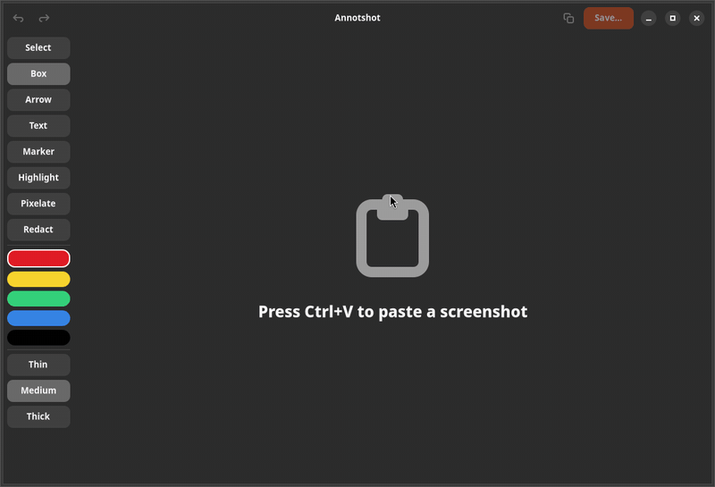

# Annotshot

A small GNOME app for annotating screenshots: paste an image from the clipboard, mark it up with boxes, arrows, text, numbered markers, highlights, pixelation and redactions, then copy or save it.

## Why

I take screenshots with GNOME's built-in tool. In a meeting I needed to add
a few words and an arrow to one, and ended up opening GIMP. That's far too
heavy for a ten-second job.

Annotshot does just that job: press Ctrl+V, mark the image up, copy or save.
It's a small native GTK4/libadwaita app that starts instantly. It doesn't
take screenshots itself, because GNOME already does that well.

Every annotation stays editable while the image is open. Drag a box's edge,
move an arrow's tip, fix a typo in a label, recolor anything, delete marker 2
and watch 3 become 2. Undo covers all of it. Lightweight annotators like
Swappy burn each stroke into the image. The editors that keep annotations
editable, such as Ksnip or Flameshot, come with their own capture workflow
and a bigger interface.

Redact paints a solid box, so hidden text is really gone. Pixelate is offered
too, marked as cosmetic only.

## Install

### Flatpak (any distribution)

Download `annotshot.flatpak` from the
[latest release](https://github.com/gappc/annotshot/releases/latest), then:

    flatpak install --user annotshot.flatpak

This also fetches the GNOME runtime from Flathub if it is missing (see
[Flathub setup](https://flathub.org/setup) if Flatpak isn't set up yet).
Annotshot then appears in the app launcher.

### From source

Needs GTK ≥ 4.16 and libadwaita ≥ 1.6 (e.g. Ubuntu 25.04 or newer):

    sudo apt install build-essential pkg-config libgtk-4-dev libadwaita-1-dev

plus a Rust toolchain via [rustup](https://rustup.rs). Then:

    ./install.sh              # builds and installs to ~/.local
    ./install.sh --uninstall

To install elsewhere, set `PREFIX`, e.g. `PREFIX=/usr/local ./install.sh` (default `~/.local`).

## Shortcuts

| Key | Action |
| --- | --- |
| V | Select |
| R | Box |
| A | Arrow |
| T | Text |
| N | Numbered marker |
| H | Highlight |
| P | Pixelate |
| X | Redact |
| Ctrl+V | Paste |
| Ctrl+C | Copy |
| Ctrl+S | Save |
| Ctrl+Shift+S | Save as |
| Ctrl+Z / Ctrl+Y | Undo / redo |
| Delete / BackSpace | Delete selection |
| Escape | Finish text |
| Enter | New line in text |

## Notes

- The last drawn or clicked item stays selected. With any tool except Text, drag its corners, its sides (boxes and redactions) or an arrow's ends to resize it. The mouse cursor changes where that's possible. With Select, drag a selected box's inside to move it. A selected marker moves by dragging its inside, with any tool except Text.
- The file name's extension decides the format when saving: `.png` → PNG, `.jpg`/`.jpeg` → JPEG, no extension → `.jpg` is added. Choosing the PNG filter in the save dialog is not enough; change the name to end in `.png`.
- **Markers** count 1, 2, 3 … in the order you place them. Deleting one renumbers the later ones. The line width sets their size.
- **Highlights** sit under all other annotations and keep dark text readable. The Highlight tool starts in yellow and remembers its own color; the other tools keep theirs.
- **Pixelate** sets its block size from the line width and, like highlights, sits under all other annotations.
- Use **Redact** (a solid box) to hide sensitive data. **Pixelate is not safe for that**: pixelated text can be reconstructed.
- A copied image stays available after you close the window: Annotshot keeps running in the background until something else is copied.

## Development

    cargo run                 # development build
    cargo test                # unit tests (model, editor, rendering, export, …)
    cargo clippy --all-targets -- -D warnings
    tests/gui/smoke.sh        # headless GUI run with screenshots, see tests/gui/README.md

GitHub Actions (`.github/workflows/ci.yml`) runs the tests, clippy and the
headless GUI run on every push, in an Ubuntu 26.04 container; the
screenshots are attached to each run.

The Flatpak recipe lives in `flatpak/`; `.github/workflows/flatpak.yml` builds
the bundle on every push and attaches it to the release when a `v*` tag is
pushed. After changing dependencies, run `python3 flatpak/gen-cargo-sources.py`.

After changes, run `./install.sh` again to update the launcher version. Design
and implementation plan: `docs/superpowers/`.

## License

Copyright (C) 2026 gappc

Annotshot is free software: you can redistribute it and/or modify it under the
terms of the GNU General Public License as published by the Free Software
Foundation, either version 3 of the License, or (at your option) any later
version. See [LICENSE](LICENSE).
